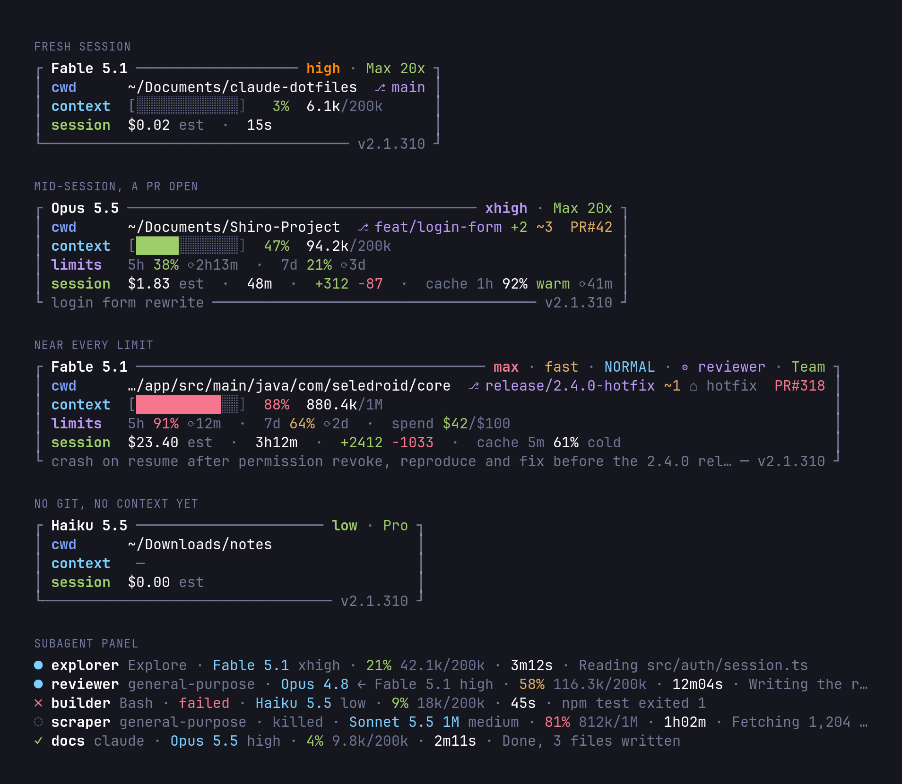

# claude-dotfiles

My Claude Code setup. One folder, linked into place, so a clone on another
machine gives the same agent.



## What's in it

```text
claude-dotfiles/
├── README.md
├── install.sh              links the three files below into place
├── CLAUDE.md               the rules, read in full every session
├── statusline.sh           the status line
├── subagent-statusline.sh  the subagent panel rows
└── statusline.png          the picture above
```

CLAUDE.md is the part worth reading. It tells the agent how to talk and how
to act: one voice on every model, check it before you say it, size the
answer to the question, name the check and say the context once, go means
go. Every line in it is read on every turn, so nothing is in there that
doesn't earn its place.

The two scripts are run by Claude Code, not read by the model.

## Install

Clone it, then from inside the folder:

```sh
./install.sh
```

Links go under `$CLAUDE_CONFIG_DIR`, or `~/.claude` when that's unset. Run
it again any time; it's idempotent. A target that already holds an
identical copy becomes a link. Anything else is left alone and reported, so
nothing gets overwritten unseen.

Then point `settings.json` in that same directory at the two links:

```json
"statusLine": {
  "type": "command",
  "command": "bash ~/.claude/statusline-command.sh",
  "refreshInterval": 2
},
"subagentStatusLine": {
  "type": "command",
  "command": "bash ~/.claude/subagent-statusline.sh"
}
```

## Memory

Not kept here. The agent writes it under `~/.claude/projects/*/memory/`
only when asked, and it stays on the machine it was written on.
